<h1 align="center">💻 Welcome to my GitHub</h1>

  <strong>Software engineer • Systems analyst • PO</strong> 
  Focused on <strong>Java, Spring Boot, Python, REST APIs, SQL, DevOps (CI/CD), Data Engineering & AI-Assisted Development</strong>

  
  
  

---

<table>
  <tr>
    <td valign="top" width="58%">

## 🚀 About Me

I am an **Information Systems** undergraduate student at **Unifacisa** and currently work as a **Junior Educational Systems Analyst**, passionate about software engineering, process automation, and problem-solving.

I have hands-on experience with **Java, Spring Boot, Python, SQL, and REST APIs**, developing internal applications, integrating enterprise platforms (**Canvas LMS** and **TOTVS RM**), and automating workflows with **CI/CD** pipelines and **Grafana** observability.

Certified in **Google UX Design**, I combine backend robustness with user-centered thinking, leveraging **AI-Assisted & Spec-Driven Development** to build complete, scalable, and high-impact applications.

 

## 📈 Currently Learning

- Cloud Computing (AWS) & Container Orchestration (Docker & Kubernetes)
- Distributed Systems & Microservices Architecture
- Modern Data Engineering (dbt, Apache Spark, Apache Iceberg & Databricks)
- Generative AI Engineering, AI Agents & Spec-Driven Workflows
- System Observability & Automated Testing Best Practices

   </td>
   <td valign="middle" width="42%" align="center">
     
   </td>
  </tr>
</table>

---

## 🛠️ Main Stack

### Backend & APIs

  

### Frontend & UX

  

### Databases, DevOps & Tools

---

## 📌 Featured Projects

<table>
  <tr>
    <td width="33%" valign="top">
      <h3><a href="https://github.com/fabiodfilho/abcode">📁 abcode</a></h3>
      
Front-end web development project structured with semantic HTML, CSS, and interactive web fundamentals.

    </td>
  </tr>
</table>

---

## 📊 GitHub Stats

  
  

 

  

---

## 🎮 Contribution Activity

  <picture>
    <source media="(prefers-color-scheme: dark)" srcset="https://raw.githubusercontent.com/fabiodfilho/fabiodfilho/output/pacman-contribution-graph-dark.svg">
    
  </picture>

---

## 🌐 Contact

  
  
  
  

 

  

